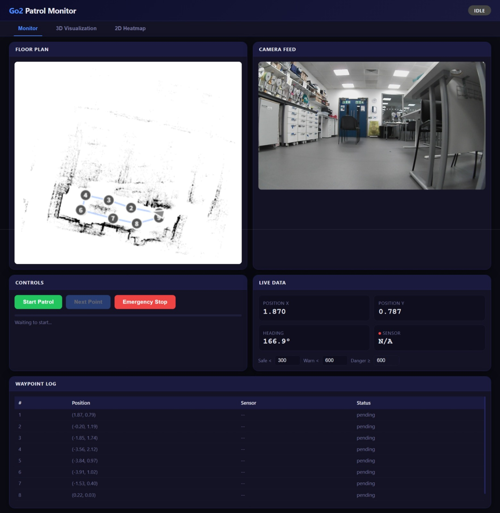
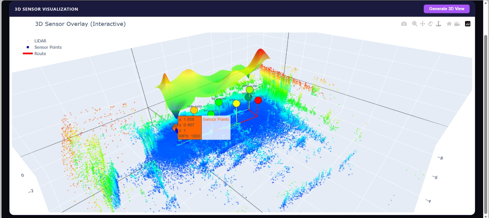
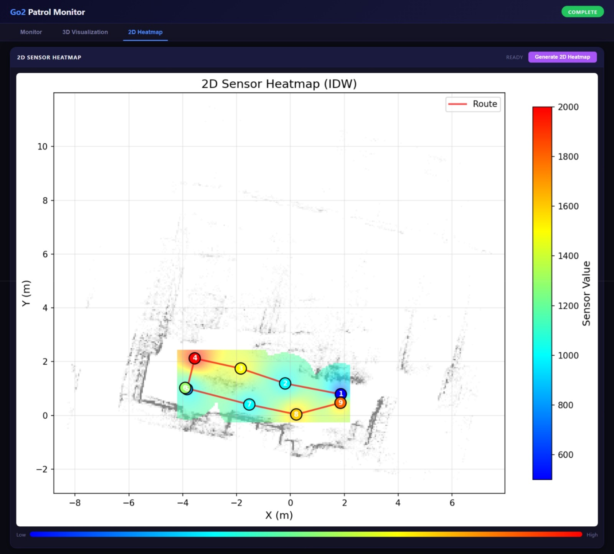
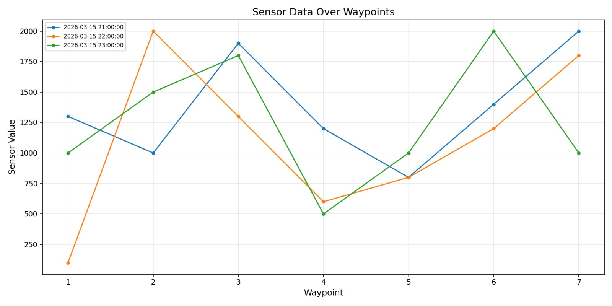

# Changelog

## [Unreleased] - 2026-03-16

### Added

#### New Scripts

- **`sensor_history_plot.py`** — Batch plot sensor data from multiple CSV files
  - Reads all `*sensor_data.csv` files from a directory
  - Plots sensor values vs. waypoint number with different colors per session
  - Automatically parses datetime from filenames for legend labels

- **`sensor_surface_sphere_overlay.py`** — 3D/2D sensor visualization
  - 3D view: Colored spheres + cylinders + interpolated mesh surface + LiDAR cloud
  - 2D view: IDW heatmap overlay on LiDAR floor plan
  - Exports interactive HTML (Plotly) and PLY files
  - Headless generation functions for web server integration

#### New Data Files

- **`history_data/`** — Directory for storing historical sensor data CSV files
- **`sensor_3d_interactive.html`** — Interactive 3D visualization (Plotly)

### Changed

#### Navigation (`auto_navigator.py`)

- **PD control algorithm** — Replaced simple P-control with PD (Proportional-Derivative) control for smoother rotation and forward movement, reducing jitter
- **Configurable tolerances** — Added `rotate_tolerance` and `move_tolerance` parameters (default: 0.05)
- **History saving** — New `save_history` option to automatically archive sensor data with timestamps
- **Improved stuck detection** — Reduced stuck detection threshold from 0.05 to 0.02 radians

#### Web Server (`web_server.py`)

- **3D visualization API** — Added `/api/generate_3d` and `/api/3d_status` endpoints
- **2D heatmap API** — Added `/api/generate_2d` and `/api/2d_status` endpoints
- **Async generation** — Background thread execution for visualization generation

#### Web UI (`web_ui.html`)

- Major UI refactoring with enhanced user experience
- Added 3D/2D visualization controls
- Improved layout and responsiveness

#### Data Files

- Updated `waypoints.json` with new waypoint definitions
- Updated `map_meta.json` with map metadata
- Updated `sensor_data.csv` with new sensor readings

---

## Usage Guide

### sensor_history_plot.py

Plot historical sensor data from multiple sessions:

```bash
# Basic usage - plot all CSV files in a directory
python sensor_monitor/sensor_history_plot.py sensor_monitor/data/history_data/

# Custom output filename
python sensor_monitor/sensor_history_plot.py sensor_monitor/data/history_data/ -o my_plot.png
```

**Input:** Directory containing CSV files named `YYYYMMDD_HHMMSS_sensor_data.csv`

**Output:** PNG image with overlaid line charts (one line per session)

### sensor_surface_sphere_overlay.py

Generate 3D and 2D sensor visualizations:

```bash
# Generate both 3D and 2D visualizations (default)
python sensor_monitor/sensor_surface_sphere_overlay.py

# 3D only
python sensor_monitor/sensor_surface_sphere_overlay.py --mode 3d

# 2D heatmap only
python sensor_monitor/sensor_surface_sphere_overlay.py --mode 2d

# Custom parameters
python sensor_monitor/sensor_surface_sphere_overlay.py --surface-lift 0.3 --z-scale 0.003 --sphere-radius 0.1
```

**Options:**

| Option | Default | Description |
|--------|---------|-------------|
| `--mode` | `both` | Visualization mode: `2d`, `3d`, or `both` |
| `--vmin` | auto | Minimum sensor value for color scale |
| `--vmax` | auto | Maximum sensor value for color scale |
| `--sphere-radius` | 0.12 | Sphere radius in meters |
| `--surface-grid` | 0.06 | Grid resolution for surface/heatmap |
| `--surface-radius` | 1.2 | IDW interpolation influence radius |
| `--surface-lift` | 0.15 | Surface height above sensor points (m) |
| `--z-scale` | 0.002 | Height scale for 3D surface curvature |
| `--hide-cloud` | false | Hide LiDAR point cloud in 3D view |

**Output Files:**

- `sensor_monitor/data/sensor_3d_interactive.html` — Interactive 3D view (Plotly)
- `sensor_monitor/data/sensor_3d_scene.ply` — 3D mesh export
- `sensor_monitor/data/sensor_heatmap_2d.png` — 2D heatmap image

**Dependencies:**

```bash
pip install numpy matplotlib open3d plotly pandas
```

### Programmatic Usage (Web Server)

Both scripts provide headless functions for server integration:

```python
# Generate 3D HTML without opening viewer
from sensor_surface_sphere_overlay import generate_3d_html_only
html_path = generate_3d_html_only()

# Generate 2D heatmap PNG
from sensor_surface_sphere_overlay import generate_2d_heatmap_only
png_path = generate_2d_heatmap_only()
```

>_All other stuff follows the weicheng's usage instructions._

## Example Data
Use this [Google Drive link](https://drive.google.com/file/d/1aNa7x8kr7Ephyaay-bgzjgUaXHLSywb8/) to download the example data zip.

Extract the `data` folder from the zip and put the folder in `sensor_monitor` directory.


## New visualization showcase



