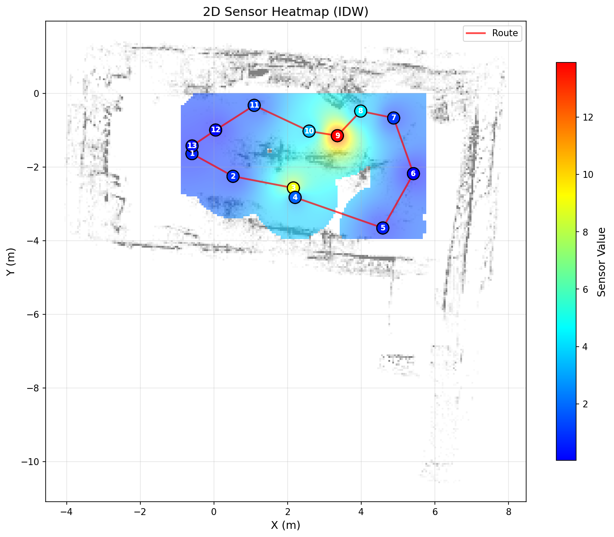

# Go2 Radiation Monitoring System

Autonomous environmental sensor monitoring using the Unitree Go2 quadruped robot. The robot builds a 3D LiDAR map of an environment, learns a monitoring route via manual walk-through, then autonomously navigates the route while collecting sensor data at each waypoint. Results are visualized as 2D/3D heatmaps overlaid on the LiDAR map.



## System Architecture

**Workflow** (teach-and-repeat):

```
1. Map            2. Record Route     3. Auto-Navigate       4. Visualize
lidar_mapper.py → route_recorder.py → auto_navigator.py   → sensor_heatmap.py
(walk + scan)     (walk + mark)       (autonomous + log)     (3D/2D heatmap)
                                      ↓
                                      auto_navigator.py --web
                                      (web UI + live camera)
```

**Sensor data flow** (optional external sensor):

```
Arduino (serial) → sensor_bridge.py (Jetson) → TCP → auto_navigator.py (PC)
```

**WiFi mode** (no ethernet cable needed):

```
PC ──WiFi/TCP──→ dds_bridge.py (Jetson) ──DDS/eth0──→ Robot
                 port 9877: commands + state (10Hz)
                 port 9878: video stream (JPEG via DDS VideoClient)
                 port 9879: LiDAR point clouds
```

## Prerequisites

### Hardware
- Unitree Go2 with L1 LiDAR
- PC on the same WiFi network as the robot
- (Optional) Arduino sensor board connected to Go2's Jetson via USB

### Software
- Python 3.10 with conda (required — cyclonedds does not support Python > 3.10)
- Unitree SDK2 Python (included in this repo as `unitree_sdk2py/`)

### Connecting to Jetson Nano via WiFi

The Go2's onboard Jetson Nano is accessible over WiFi once the robot is powered on
and connected to your WiFi network.

| Network | IP | Purpose |
|---------|-----|---------|
| WiFi (same as your PC) | `192.168.0.207` | SSH access, bridge TCP ports |
| Internal ethernet (to robot) | `192.168.123.18` | DDS communication with robot |

```bash
# SSH into the Jetson (password: 123)
ssh unitree@192.168.0.207
```

## Installation

### SDK setup

```bash
git clone git@github.com:tommyhuangtw/go2_radiation_monitoring.git
cd go2_radiation_monitoring

# Create conda env (cyclonedds requires Python ≤ 3.10)
conda create -n go2 python=3.10 -y
conda activate go2

# Install SDK + dependencies
pip install -r requirements.txt
pip install -e .
```

### Troubleshooting: cyclonedds

If `pip install -e .` fails with:

```
Could not locate cyclonedds. Try to set CYCLONEDDS_HOME or CMAKE_PREFIX_PATH
```

Build cyclonedds from source first:

```bash
cd ~
git clone https://github.com/eclipse-cyclonedds/cyclonedds -b releases/0.10.x
cd cyclonedds && mkdir build install && cd build
cmake .. -DCMAKE_INSTALL_PREFIX=../install
cmake --build . --target install
```

Then re-install with the path set:

```bash
cd ~/go2_radiation_monitoring
export CYCLONEDDS_HOME="~/cyclonedds/install"
pip install -e .
```

See [cyclonedds PyPI docs](https://pypi.org/project/cyclonedds/#installing-with-pre-built-binaries) for details.

### WiFi bridge deployment

The DDS protocol used by the Unitree SDK only works over ethernet. `dds_bridge.py`
runs on the Jetson and bridges DDS to TCP, so all PC scripts can work over WiFi.

**One-time setup:**

```bash
# Copy SDK + bridge script to Jetson
scp -r unitree_sdk2py sensor_monitor/dds_bridge.py unitree@192.168.0.207:~/

# SSH in and install cyclonedds
ssh unitree@192.168.0.207
pip3 install cyclonedds==0.10.2
```

**Start the bridge (run each session):**

```bash
ssh unitree@192.168.0.207
python3 ~/dds_bridge.py --interface eth0 --video --lidar
```

This starts all three relay services:
- **Port 9877** — robot state (10 Hz) + commands (move, standup, etc.)
- **Port 9878** — camera video stream (JPEG frames via DDS VideoClient)
- **Port 9879** — LiDAR point cloud stream

You can omit `--video` or `--lidar` if you don't need camera or LiDAR relay.

**Safety:** The bridge has a 250ms deadman timeout — if no move command arrives
(e.g. WiFi drops), the robot stops automatically. It also stops on client
disconnect and when a new client connects.

### Sensor bridge deployment

If using an external Arduino sensor connected to the Go2's Jetson:

```bash
# Copy bridge script to Jetson
scp sensor_monitor/sensor_bridge.py unitree@192.168.123.18:~/

# SSH in and add user to dialout group (one-time)
ssh unitree@192.168.123.18
sudo usermod -aG dialout unitree
# Log out and back in for group change to take effect
```

## Quick Start

> **Important — shared origin:** The robot's odometry resets to (0, 0, 0) on
> every boot. All three scripts (mapping, route recording, auto-navigation)
> must use the **same physical starting position and heading**. Mark the spot
> and direction with tape before you begin. If you reboot between steps,
> re-place the robot on the mark facing the same way.

> **WiFi assumed:** The commands below use WiFi mode (`--bridge`) with
> `dds_bridge.py` running on the Jetson (see [WiFi bridge deployment](#wifi-bridge-deployment)).
> For direct ethernet, omit `--bridge` and use `--interface enp0s2`.

### 0. Start the bridge on Jetson

```bash
ssh unitree@192.168.0.207
python3 ~/dds_bridge.py --interface eth0 --video --lidar
```

Leave this running for the entire session. All steps below connect to it.

### 1. Build the LiDAR map

Place the robot on the taped starting mark (see above). Walk it slowly through the environment while the script records 3D point cloud data.

```bash
python sensor_monitor/lidar_mapper.py --bridge 192.168.0.207
```

The script continuously accumulates LiDAR scans into memory at 5 Hz (configurable
via `--throttle`). Just walk the robot around — no button presses needed during
mapping. Press `[q]` or Ctrl+C when done; the point cloud auto-saves on exit.

Generates `sensor_monitor/data/point_cloud.ply` and `sensor_monitor/data/floor_plan.png`.

### 2. Record monitoring waypoints

**Same boot session, same starting position.** Walk the robot to each monitoring location and press Enter to mark it.

```bash
python sensor_monitor/route_recorder.py --bridge 192.168.0.207
```

Press `[q]` to save and quit. Generates `sensor_monitor/data/waypoints.json`.

### 3. Verify alignment

Check that waypoints align with the LiDAR map:

```bash
python sensor_monitor/sensor_heatmap.py --cloud-only
```

This runs locally on PC (no robot connection needed). The red spheres and line should overlay the point cloud correctly. If waypoints appear outside the map, re-record both in the same boot session.

### 4a. Run autonomous monitoring (CLI)

Place the robot on the taped starting mark (same position + heading as mapping), then:

```bash
python sensor_monitor/auto_navigator.py --bridge 192.168.0.207 --no-sensor
```

Remove `--no-sensor` if an Arduino sensor is connected. Add `--loop` for continuous patrol.

### 4b. Run autonomous monitoring (Web UI)

```bash
python sensor_monitor/auto_navigator.py --web --bridge 192.168.0.207 --no-sensor
```

Requires `--video` on `dds_bridge.py` for the live camera stream. Remove `--no-sensor` if an Arduino sensor is connected.

Open `http://localhost:8080` in your browser. The web UI provides:

- **Live floor plan** with robot position and waypoint status
- **Live camera** stream from the robot's front camera
- **Start Patrol** button to begin autonomous navigation
- **Next Point** button to advance to the next waypoint after data collection
- **Emergency Stop** to halt the robot immediately
- **Live sensor data** with user-configurable safe/warning/danger thresholds
- **Heatmap** automatically displayed after all waypoints are collected

### 5. Visualize results

```bash
# Both 3D + 2D
python sensor_monitor/sensor_heatmap.py

# 2D heatmap only
python sensor_monitor/sensor_heatmap.py --mode 2d
```


## Script Reference

| Script | Purpose | Run on |
|--------|---------|--------|
| `lidar_mapper.py` | Walk robot to build 3D LiDAR point cloud + 2D floor plan | PC |
| `route_recorder.py` | Walk robot, press Enter to mark monitoring waypoints | PC |
| `auto_navigator.py` | Auto-navigate waypoints, collect sensor data at each stop | PC |
| `auto_navigator.py --web` | Web UI with live map, camera, controls, and heatmap | PC |
| `sensor_heatmap.py` | Visualize sensor readings on 3D point cloud + 2D floor plan | PC |
| `sensor_bridge.py` | Arduino serial to TCP bridge (stdlib only, no pip needed) | Jetson |
| `dds_bridge.py` | DDS-to-TCP bridge for WiFi control, video relay, LiDAR relay | Jetson |
| `wifi_bridge_client.py` | TCP client for dds_bridge (SportClient-compatible interface) | PC |
| `web_server.py` | FastAPI backend for web UI (used internally by `--web` flag) | PC |

All scripts are in `sensor_monitor/` and write data to `sensor_monitor/data/`.

## Data Files

| File | Generated by | Description |
|------|-------------|-------------|
| `point_cloud.ply` | lidar_mapper.py | 3D point cloud (PLY format) |
| `floor_plan.png` | lidar_mapper.py | 2D top-down occupancy image |
| `floor_plan.npy` | lidar_mapper.py | Raw 2D occupancy grid (numpy) |
| `map_meta.json` | lidar_mapper.py | Grid metadata (resolution, origin, size) |
| `waypoints.json` | route_recorder.py | Monitoring waypoints (x, y, yaw) |
| `sensor_data.csv` | auto_navigator.py | Timestamped position + sensor readings |

Data files are large and excluded from git via `.gitignore`.

## Important Notes

- **Shared origin**: All scripts share one odometry frame anchored at the robot's boot-up position. Steps 1-2 (mapping + waypoint recording) must happen in the same boot session. Step 4 (auto-navigation) can be a later session, but the robot must start at the same taped position and heading. The navigator applies a small rigid-body correction, but large offsets will cause navigation errors.
- **WiFi vs ethernet**: Use `--bridge 192.168.0.207` for WiFi mode (recommended). For direct ethernet without the bridge, omit `--bridge` and use `--interface enp0s2`.

## Known Limitations

- Robot odometry drifts over long routes (no loop closure)
- No obstacle avoidance during autonomous navigation (uses `SportClient.Move`)
- Sensor bridge supports one TCP client at a time
- 3D visualization requires a display (X11/Wayland) — use `--mode 2d` over SSH
- WiFi video/LiDAR relay adds latency compared to direct ethernet DDS

## Upstream SDK

This project is built on top of [`unitree_sdk2_python`](https://github.com/unitreerobotics/unitree_sdk2_python). The `unitree_sdk2py/` directory is the unmodified upstream SDK. See the upstream repo for SDK documentation, DDS setup, and low-level API examples.
